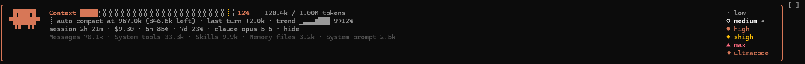

# context-meter — a Claude Code mod

See your context window fill up as you work, without typing `/context`. A live band
above the prompt shows an animated fill bar, the token count, headroom before
auto-compaction, the usage trend, session cost and rate limits. It also has a one-click
effort picker and Clawd, who types while Claude works, dresses up for the effort level and naps when you're idle.



## Install

Requires Claude Code 2.1.296 or later. Type this at the prompt of a terminal session:

```
/plugin install context-meter --marketplace Krs7N/context-meter
```

1. Answer `y` to **Add marketplace?** (`github:Krs7N/context-meter`).
2. Press Enter to keep the **user** scope, so the mod loads in every session.
3. Claude Code prints `Installed context-meter. Plugin is now active.` The band appears above the prompt right away.

**Update** to a newer version with `/plugin update context-meter`. **Remove** the mod with `/plugin uninstall context-meter`.

### Run it from a clone instead

```
git clone https://github.com/Krs7N/context-meter
claude --plugin-dir ./context-meter
```

To load it in every session without a marketplace, add the clone's path to the `env` block in `~/.claude/settings.json`:

```json
{ "env": { "CLAUDE_CODE_PLUGIN_DIRS": "C:/path/to/context-meter" } }
```

On Windows, separate several paths with `;`. On macOS and Linux, use `:`.

## What it shows

| Row | Content | Source |
| --- | --- | --- |
| 1 | `Context` + fill bar + percent + `tokens / window`; model badge and effort badge on the right | `$.session.usage().context` (`tokens`, `window`, `percent`); model and effort: see below |
| 2 | in this order, each only when it applies: `! 150.0k over the 200.0k window: next send compacts` (or `: /compact before sending` with auto-compaction off), in red; `window 1.00M → 200.0k` for about 10 s after a model switch; `┊ auto-compact at 167.0k (83.0k left)` (the same `┊` as on the bar); the turn: `this turn +12.0k` while Claude works, `compacted 182.0k → 31.0k` after a compaction, else `last turn +3.2k`; fill trend `trend ▁▂▃▅▇ 12→42%` | `context.breakdown`; each main-thread request's usage; the turn ends; `trend` state |
| 3 | session duration, session cost, rate-limit windows (`5h`, `7d`, `spend`) | `startedAt` and the clock, `cost.usd`, `rateLimits` |
| 4 (optional) | the 5 largest used categories, as `/context` splits them | `breakdown.categories` (kind `used`) — toggled by the **details** button |

- Bar color: Claude orange (`claude` theme key), then `warning` and `error` as the fill nears the auto-compact point (from three quarters of the way, and from 95 %). With no auto-compact point known: `warning` from 60 %, `error` from 80 % of the window (`fillColor`).
- The bar fills in eighth-block steps (`▏▎▍▌▋▊▉█`), so it moves smoothly. It is up to 40 cells wide.
- A `┊` mark on the empty part shows where auto-compaction runs.
- The meter moves with each model request of a running turn, not only when the turn ends.
- When a reading raises the fill, the newly added part is drawn bold blue (`suggestion`) for about 10 s. The percent then shows `▲` (or `▼` when it drops).
- **Change highlight:** every number that changed since the last reading is drawn bold blue for about 10 s (`HIGHLIGHT_TICKS` × 0.7 s). This covers tokens, tokens left before compaction, the turn's growth, percent, cost and each rate-limit percent. Unchanged numbers stay dim. A new window (a model switch) is no growth: no `▲`, no count-up, just the `window …` note.
- **Count-up:** a changed number does not jump to its new value. It counts there from the old one over 6 s with an ease-out (`TWEEN_STEPS` × `TWEEN_MS`), and the bar grows with it. A newer reading restarts the count.
- **Trend:** the tokens at the last 8 turn ends, scaled to the values shown, then first→last as percents of the window shown now, so a switch to a smaller window draws no spike.
- **Over the window:** the engine caps the percent at 100, so a context bigger than the window (after a switch to a smaller model) shows as red tokens and the warning at the start of row 2.
- Below 72 terminal columns, or when the full band is taller than the room above the prompt (`maxRows`, a short fullscreen terminal), only row 1 and the two badges are drawn, without frame and mascot.
- Before the first reply of a session (or right after `/clear`) the token count shows "waiting for the first reply". Right after a compaction it shows what the compaction left, `~31.0k / 200.0k tokens`, until the next reply.
- `/clear` and `/resume` start the meter over: no growth or trend is measured against the conversation before.

## Model badge

Left of the effort badge: `◇ Opus 5.5 ▾`, the main loop's model as `/model` shows it (`$.session.model()`, read at start, after every `/model` and every 1.4 s, so a change made anywhere shows up). A 1M-context variant reads `◇ Opus 5.5 · 1M`.

When the model changes, the meter reads the new window, auto-compact point and saved effort at once, without waiting for the next turn.

**Click it** to open a picker column around the badge, in the order `haiku sonnet opus fable` (`MODEL_CHOICES`): smaller models stack above the badge, larger ones below. A pick runs `/model <alias>` exactly as if you typed it, so Claude Code's own model changes, and whether it is saved as your default follows `/model`'s own rules. Only one picker is open at a time: opening one closes the other.

When Claude Code keeps the model (`/model` answers "Kept model as …"), the mod shows a toast: `Claude Code kept Opus 5.5: /model sonnet did not switch`. Typing the command answers the same, so the toast suggests nothing. Plugins may not submit slash commands themselves.

## Effort badge

The badge grows louder with the effort level:

| Effort | Drawn as |
| --- | --- |
| `low` | `· low`, dimmed |
| `medium` | `○ medium` |
| `high` | `● high`, bold orange |
| `xhigh` | `◆ xhigh`, bold `warning` |
| `max` | ` ▲ MAX `, filled `error` badge |
| ultracode | ` ✦ ULTRACODE · <LEVEL> `, filled orange badge (beats every level) |
| token budget | `effort 32.0k budget` |
| none (a model that takes no effort) | `– no effort`, dimmed |

**Click it** to open a picker column around the badge, in the order `low medium high xhigh max ultracode`: lower levels stack above the badge, higher ones below it, and the ultracode switch comes last. Click the badge again to close it. The **details**/**hide** toggle sits at the end of row 3, away from the picker. A pick runs `/effort <choice>` exactly as if you typed it (`$.command.run`), so Claude Code's own setting changes. Whether it is saved as the default follows `/effort`'s own rules. If `/effort` prints nothing the mod can read, the badge shows what was picked. Ultracode rides on top of a level: picking a level while it is on changes the level and keeps ultracode on, as `/effort` itself does (badge `✦ ULTRACODE · XHIGH`). Only the last option, `✦ ultracode off` (`/effort ultracode off`), turns it off.

The level comes from these sources:

- `command.run` on `/effort` (picked from the badge, or typed where the hook sees it): the mod reads the output: "Set effort level to …", "Ultracode on/off", "Effort stays …".
- `prompt.submit` of a typed `/effort <level>`, `/effort ultracode [on|off]`: read from the arguments. `max` and ultracode are session-only and saved nowhere else the mod could read.
- `turn.step` on the main thread (no `agentId`): the effort every request actually sends, after any downgrade for the model. A request with none means the model takes no effort (`– no effort`). Subagents' requests are ignored.
- A `/config` row named `effort…`, when this build has one: a starting value, read only until a request or a pick names the level.
- Saved settings, polled every 1.4 s and after a model switch: `modelSettings[<model>].effortLevel` (the key matched by id or by the name `/model` shows), else `effortLevel`. This catches Claude Code's own `/effort` panel, which no hook sees. It applies only when the saved value changes.

Ultracode starts off in every session (it is per session). A prompt that only mentions the word "ultracode" does not turn the badge on.

## The mascot (Clawd)

Clawd as the Claude Code welcome banner draws him, in the frame's left corner, sitting behind a keyboard: two rows of keycaps on a dark gray case (a key, the spacebar and a key on top; six keys below; `CLAWD.keyboard`).

- Idle: blinks for one tick (0.7 s) about every 4.2 s (every 6th tick). Shut eyes are thin dark lines (`CLAWD.shutEye`), so he never looks eyeless.
- While Claude works (`isWorking`): he types. One arm reaches down at a time (`CLAWD.typing`) and a key under that hand lights up blue, a different one each frame (`litKey`, from `CLAWD.keysLeft` / `CLAWD.keysRight`).
- He dresses for the effort level (`outfitFor`, `clawdRows`):

  | Effort | Outfit |
  | --- | --- |
  | low | none |
  | medium | a blue cap, facing front |
  | high | the cap plus a bottle in a holder strapped to each side, straws running into his face |
  | xhigh | cap, bottles and straws, plus glasses with round white rims around his eyes |
  | max, ultracode | a tall purple magician's hat with a gold band, and nothing else |

  He is 13 cells wide in every outfit, so the stats beside him never move.
- Asleep: after 3 minutes without activity (`SLEEP_AFTER_TICKS`), he leaves the keyboard (his legs show again in its place), his eyes close (inside the glasses too) and "zZzZ" grows out from the top-left of his head, in an extra row above him and any hat. He keeps his outfit while asleep. A prompt, a model request or a new reading wakes him (`markActive`).
- Frames live in the `CLAWD` constant in `hooks/register.tsx`; the timing in
  `TICK_MS` (tick length) and `BLINK_EVERY` (ticks between blinks).

## The timer

All animation (mascot frames, count-up) runs on one `$.clock.every(100 ms)` interval (`startTicker`). Work that a hook starts with `sleep` loops dies when that hook's dispatch ends, because each hook has a time budget and sleeps count against it. An engine interval runs until it is cancelled or the module reloads. `session.start` starts the interval and lands any count-up a reload interrupted. `session.measure`, `prompt.submit` and `/effort` restart it if it is missing, because a `/clear` fires no new `session.start`. `session.end` stops it, except on `/clear` and `/resume`, which keep it and start the meter over 0.3 s later.

Every `/effort` writes a line to the debug log (`claude --debug`): `context-meter: /effort <args> → "<output>" (applied: …)`. If `/effort` was given a level and the mod could not read its output, the line also goes to the transcript.

## When it refreshes

| Event | What happens |
| --- | --- |
| `session.start` | first reading; starts the mascot's animation loop |
| `session.measure` | a turn end (the fill moved): a reading with breakdown, the turn's growth and a trend point; a cost or rate-limit move alone: a plain reading |
| `turn.step` | each main-thread request: its effort level, then a live reading from the response's own usage |
| `session.compact` | a main-conversation compaction: records what it freed and redraws |
| `session.end` | `/clear` and `/resume`: start the meter over; anything else: stops the animation loop |
| `prompt.submit` | wakes Clawd; reads a typed `/effort …` |
| `command.run` (`effort`) | reads the level and ultracode state back from `/effort`'s output |
| `command.run` (`model`) | reads the model back (`$.session.model()`) once `/model` ran; a new model gets a full reading |
| `ui.render` (`AbovePrompt`) | draws the band from the stored state; yields to surveys (`hasSurvey`) |

Turn ends, model switches and compactions call `$.session.usage({ breakdown: 'summary' })`.
A `summary` breakdown is estimated locally — no token-count API calls, no cost. (`'full'`
would count with the API, as `/context` does.) Live readings and cost-only measures read
the plain figures, which cost nothing.

## Files

| File | Purpose |
| --- | --- |
| `.claude-plugin/plugin.json` | manifest (name, version, description, `types`) |
| `hooks/hooks.json` | points to the hooks module |
| `hooks/register.tsx` | all logic: refresh, animation, rendering, formatting helpers |
| `types/index.d.ts` | state contract under `context-meter`: `snap`, `trend`, `frame`, `effort`, `model`, the pickers' open flags, … |
| `tests/meter.test.ts` | formatting, band contents and redraw, layouts, model switches, live readings, `/clear`, `/resume`, `/compact`, blink timing |
| `README.md` | this document |

## Common edits

- **Change the colors** — the thresholds in `fillColor` and the `color="claude"` props in the `ui.render` hook. Any theme key works (`success`, `warning`, `error`, `subtle`, `permission`, …).
- **Bar width** — `const width = Math.max(10, Math.min(40, …))` in the render hook.
- **One-line cut-off** — `const isCompact = columns < 72 || fullRows > e.props.maxRows`.
- **Trend length** — `TREND_LEN` (shown), `TREND_KEEP` (stored).
- **Add a metric** — add a field to `Snapshot` in `types/index.d.ts`, fill it in `toSnapshot`, print it in `line2` / `line3`.
- **More categories in details** — `.slice(0, 5)` in `toSnapshot`.

## Working on it

Run from the folder that holds the clone:

```
claude plugin validate context-meter
claude plugin test context-meter
```

Type-check: once Claude Code has loaded the mod (`claude --plugin-dir ./context-meter`), `.claude-plugin/types/` holds the engine's types (gitignored) and `npx -p typescript tsc -p context-meter` works.

Releasing: bump `version` in `.claude-plugin/plugin.json` and `.claude-plugin/marketplace.json`, add a `CHANGELOG.md` entry, then commit and push. Installed copies pick it up with `/plugin update context-meter`.
